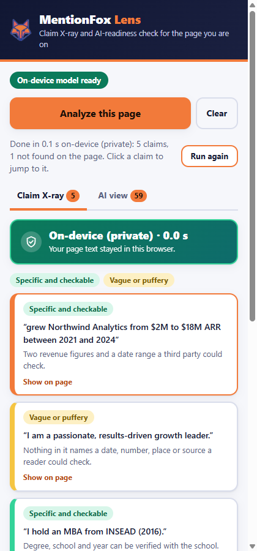

# MentionFox Lens

Free, open-source Chrome extension (Manifest V3) that reads the page you are on and does two things:

1. **Claim X-ray.** Finds the factual claims on the page (profile, bio, press release, pitch, post), highlights each one in place, and labels it *specific and checkable* or *vague or puffery* with a one-line reason. A side panel lists the claims; clicking one scrolls to the exact highlighted text and flashes it.
2. **GEO lens.** Shows how an AI assistant would summarise the page: the people, companies and products it would pick up, the facts it would state, what is missing or ambiguous, three concrete fixes, and a 0 to 100 score with a plain explanation of each range.

Every run shows a large colour **mode bar** at the top of both results tabs (teal shield, "On-device (private) · 1.4 s", or blue cloud, "Cloud · 3.2 s"; "Cloud (on-device not ready)" when the on-device model was still downloading or failed), and the status line repeats it ("Done in 3.2 s on Cloud: 10 claims."), so you can see hybrid inference working.

Built for the [#BuildHybridAI 2026 hackathon](https://firebasehybridaihackathon.devpost.com/) with **Firebase AI Logic hybrid inference**: the model runs on-device with **Gemini Nano in Chrome** when it is available, and falls back to the cloud when it is not.

Free to use. No account, no paywall, nothing sent to MentionFox servers. The two links at the bottom of the panel open MentionFox in a new tab and are the only upsell: "Verify these claims against public registers" goes to the MentionFox Source Check page (`/source-check`) and "Find contact details for a decision maker" goes to the MentionFox Find Contact tool (`/tools/find-contact`), both with `utm_source=lens&utm_medium=extension&utm_campaign=hybridai`.

<!-- Screenshots: add real captures from a Chrome with the on-device model (see "What the owner must test"). -->
| Claim X-ray | AI view | Highlights in place |
|---|---|---|
|  |  |  |

The screenshots above are **test-harness captures with a mocked model on a synthetic fixture page** (see "Verification"). They show the UI, not real model output. Real captures from the real cloud path on four real pages are in [`docs/real-runs/`](docs/real-runs/) (each folder has `panel-claims.png`, `page-highlights.png`, `panel-geo.png`); they show the **Cloud** mode (their screenshots predate the larger mode bar), because on-device Gemini Nano could not run on the build machine.

## How hybrid inference is used

All AI calls live in [`src/ai.js`](src/ai.js) and run in the side panel (an extension page), where Chrome's `LanguageModel` API is visible to the SDK.

| What | Where |
|---|---|
| Imports `getAI`, `getGenerativeModel`, `InferenceMode`, `InferenceSource` from `firebase/ai` | `src/ai.js` line 5 |
| Firebase App Check (debug token in dev builds), then `getAI(app, { backend: new GoogleAIBackend() })` | `getAiInstance()` |
| `getGenerativeModel(ai, { mode: InferenceMode.PREFER_ON_DEVICE, onDeviceParams, inCloudParams })` | `createHybridModel()` |
| On-device structured output: `onDeviceParams.promptOptions.responseConstraint` (JSON Schema). Cloud structured output: `inCloudParams.generationConfig.responseSchema` built by `toFirebaseSchema()` | `createHybridModel()` |
| `model.initializeDeviceModel(onProgress)` starts the on-device download from the Analyze click (user gesture) and reports progress, shown as a progress bar | `initDevice()` |
| `model.generateContent(prompt)`, then `response.inferenceSource` (`on_device` or `in_cloud`) feeds the mode bar. If the SDK reports no source, the bar falls back to the `LanguageModel.availability()` reading and is labelled "mode inferred" | `runTask()` |
| Quality fallback: if an on-device answer cannot be parsed, retry once with `InferenceMode.ONLY_IN_CLOUD` | `runTask()` |
| Availability probe (`LanguageModel.availability()`) for the status chip: ready, needs download, downloading, not available | `probeDevice()` |

Behaviour when the on-device model is missing: the SDK routes the request to the cloud (`PREFER_ON_DEVICE`), the mode bar says "Cloud", and the status chip explains why. While a download runs, requests are served by the cloud and the chip shows the live percent ("On-device model: downloading 42%") with a progress bar, driven by the SDK's `initializeDeviceModel(progress)` callback; when it finishes the chip turns green ("On-device model ready") and the next Analyze (button **Run again**) uses the on-device model.

The prompts and JSON schemas are in [`src/shared/prompts.js`](src/shared/prompts.js). Instructions are inside the prompt text because the SDK's on-device adapter does not pass a system instruction. Page text is capped at 12,000 characters to stay inside the on-device token budget.

Cloud fallback model: the SDK's hybrid default, `gemini-3.5-flash-lite` (set in `CLOUD_MODEL`).

## Privacy

- On-device where possible: when Chrome can run the on-device model, the page text never leaves your computer.
- Cloud fallback: when it cannot, the page text is sent to **Firebase AI Logic** (Google), and only when you click **Analyze**. Nothing is sent when you just browse.
- Nothing is sent to MentionFox servers. The extension has no MentionFox backend and no analytics.
- The extension reads a tab only when you act on it: it uses `activeTab` and `chrome.scripting` on demand. There is no always-on content script and no host permission.
- The links to MentionFox carry only UTM tags, never page content.

Permissions: `activeTab`, `scripting`, `sidePanel`. Nothing else.

## Judges' path

1. **Clone and build.**
   ```bash
   git clone https://github.com/OsakaSaul/mentionfox-lens.git
   cd mentionfox-lens
   npm install
   npm run build:dev
   ```
   Node 20 or newer. This writes the extension to `dist/`.
2. **App Check debug token (needed only for the cloud fallback).** The extension's Firebase web config is public and already in the repo (project `mentionfox-lens`). The cloud path is protected by Firebase App Check and the repo's own registered debug token is **not published in the repo** (it is a credential). A judge has three options:
   - Use the token supplied in the owner's Devpost submission instructions, if the hackathon form allows one. The owner's assistant will provide it there, never in this repository. Put it in a gitignored `.env.local` as `APPCHECK_DEBUG_TOKEN=<token>` before `npm run build:dev`.
   - Or point the build at your own Firebase project with AI Logic enabled (see "Firebase config" below), run `npm run build:dev` without a token, open the side panel DevTools console, copy the "Firebase App Check debug token" line it prints, and register it under App Check > Apps > Manage debug tokens in your own project.
   - Or test the on-device path only (step 5): it does not call App Check or the cloud.
3. **Load unpacked.** `chrome://extensions`, Developer mode on, **Load unpacked**, choose `dist/`. Pin MentionFox Lens.
4. **Analyze a page.** Open any normal web page (a press release, a bio, a company homepage), click the Lens icon, click **Open Lens side panel**, then **Analyze this page**. One click runs both checks. You will see: a status chip about the on-device model; the **Claim X-ray** tab with each claim as a green (specific and checkable) or amber (vague or puffery) card with a one-line reason, the same sentences highlighted in place on the page, and the mode bar with the latency in seconds (about 3 to 4 s on the cloud path in our runs); clicking a card scrolls to the sentence and flashes it. The **AI view** tab shows the 0 to 100 score with what each range means, the people, companies and products it would pick up, facts, what is missing, 3 fixes, and how the score is built. **Clear** removes the highlights.
5. **On-device path.** Needs desktop Chrome 139 or newer on hardware that meets Chrome's on-device model requirements, with `chrome://flags/#prompt-api-for-gemini-nano` set to Enabled and (if listed) `chrome://flags/#optimization-guide-on-device-model` set to Enabled BypassPerfRequirement, then a restart, then `chrome://components` > Optimization Guide On Device Model > Check for update until the version is not 0.0.0.0. The chip then reads "On-device model ready" (green), or "not downloaded yet" with a **Download on-device model** button (Chrome only lets a page start the download from a click; Analyze also starts it), or "downloading NN%" with a progress bar while the cloud answers. The mode bar reads **On-device (private)** when Gemini Nano answered and **Cloud** when Firebase AI Logic's cloud model answered.
6. **Fallback.** Without a usable on-device model the SDK (`InferenceMode.PREFER_ON_DEVICE`) routes to the cloud, the mode bar says **Cloud** and the chip says on-device is not available. If an on-device answer cannot be parsed, Lens retries once in the cloud and says so in the mode bar ("Cloud (on-device failed)").

**What was and was not verified:** the cloud path (App Check with a registered debug token, Firebase AI Logic, structured output, highlighting, UI) was run for real on 2026-11-23, see "Run log" and [`docs/real-runs/NOTES.md`](docs/real-runs/NOTES.md). The on-device path was **not** run by the authors (the available Chromium 151 reports Gemini Nano as unavailable); it is implemented against the SDK's documented hybrid API and needs a real Chrome with Gemini Nano to confirm.

## Setup

Requirements: Node 20+, Chrome 139+ on desktop for the on-device path (cloud fallback works in any Chromium that supports side panels).

```bash
git clone https://github.com/OsakaSaul/mentionfox-lens.git
cd mentionfox-lens
npm install
npm test                 # unit tests
npm run build:dev        # dev build with the App Check debug provider
```

Load unpacked: open `chrome://extensions`, turn on Developer mode, click **Load unpacked**, pick the `dist` folder. Pin the Lens icon. On a page, click the icon, then **Open Lens side panel**, then **Analyze this page**. (An `Alt+Shift+L` shortcut is registered for the same action; it has not been tested.)

`npm run build` makes a release bundle (minified, no debug provider).

### Firebase config

The public web config is committed in [`src/firebase-config.js`](src/firebase-config.js) (project `mentionfox-lens`). These values are identifiers, not secrets. To point a build at your own Firebase project, create `.env.local` (gitignored) with any of `FIREBASE_API_KEY`, `FIREBASE_AUTH_DOMAIN`, `FIREBASE_PROJECT_ID`, `FIREBASE_STORAGE_BUCKET`, `FIREBASE_MESSAGING_SENDER_ID`, `FIREBASE_APP_ID`; the build overrides the committed values with them.

Your project needs Firebase AI Logic enabled with the Gemini Developer API. Restrict the API key to the AI Logic and App Check APIs; browser-key referrer restrictions must allow your `chrome-extension://<id>/*` origin.

### App Check debug token (dev builds)

Firebase AI Logic requires App Check. A Chrome extension cannot load reCAPTCHA (remote code), so builds for this project use the **debug provider**:

1. `node scripts/gen-debug-token.mjs` writes a random UUID to `.env.local` as `APPCHECK_DEBUG_TOKEN` (gitignored).
2. `npm run build:dev` sets `self.FIREBASE_APPCHECK_DEBUG_TOKEN` to that value before `initializeAppCheck` (see `getAiInstance()` in `src/ai.js`). If you build without a token, the dev build sets it to `true` instead and the SDK prints a fresh token in the side panel's DevTools console ("Firebase App Check debug token: ...").
3. In the Firebase console go to **App Check > Apps > your web app > Manage debug tokens** and register that value.

The token lives only in `.env.local` and in dev bundles under `dist/` (gitignored). It is never committed. Release builds contain no debug provider, so **cloud fallback in a release build will be refused by App Check** until an attestation path exists for extensions; the on-device path does not call App Check. The hackathon rules say debug tokens are accepted in submissions.

## Tests and verification

```bash
npm test          # 79 unit tests (parsing, matching, GEO score, manifest, real-run regression)
npm run e2e       # loads the built extension in Chromium against HTML fixtures; model MOCKED
node scripts/live-probe.mjs   # real, unmocked run of the dev build; writes docs/live-probe.txt
node scripts/live-probe.mjs --fixture fixtures/real/founder-bio.html   # same, on a saved real page; writes docs/real-runs/founder-bio/ (raw model JSON, screenshots)
```

Unit tests cover: prompt and JSON parsing with fenced, trailing-text, trailing-comma, truncated and garbage output; claim-to-range matching (whitespace, NBSP, case, curly quotes, dashes, footnote markers, the five matcher tiers incl. a renamed name and a paraphrase, multi-element ranges, re-render recovery, Custom Highlight API fallback), the checkable-anchor override and safe truncation of reasons, a regression test with two real sentences on a saved Wikipedia page (`test/fixtures/wikipedia-*.html`) against four HTML fixtures shaped like a LinkedIn profile, an X post, a company site and a news article; the GEO score and bands; and manifest rules (MV3, permission allow-list, no host permissions, CSP, no remote scripts, no eval in the bundle, tooltips and accessible names on every control, no model names in UI strings).

The fixtures in `test/fixtures/` are **hand-written approximations of those layouts**, not saved copies of real pages. Separately, `fixtures/real/` holds four saved real public pages (a founder bio, a press release, a company homepage, a news article; URLs and dates in `fixtures/real/README.md`) used for the real runs below. Nothing was logged in to. Real LinkedIn and X markup changes often; the matcher works on rendered text, not class names, which is why it should survive that, but it has not been run on the live sites.

The e2e run (`docs/e2e-run.txt`) verifies the extension loads, the content script is injected on demand, claims are wrapped in place, a click on a claim scrolls to and flashes the exact text, clear removes everything, and the mode bar renders in all four states (cloud while the model downloads, cloud when unavailable, on-device, on-device failed then cloud) with the download percent chip (0, 42, 100) turning green. Screenshots of each state: `docs/demo/mode-states/`. **The model is mocked there**, so it says nothing about model quality or about Gemini Nano.

### Run log

| Mode | Status | Evidence |
|---|---|---|
| On-device (Gemini Nano) | **Not run.** The Chromium used for CI (version 151) exposes `LanguageModel` but reports `availability() = unavailable`, with or without the Prompt API feature flags, so no on-device answer was produced. | `docs/live-probe.txt`, `docs/live-probe-nano-flags.txt` |
| Cloud fallback (Firebase AI Logic, App Check debug token registered) | **Run for real.** `node scripts/live-probe.mjs` returned "Done. 8 claims, 1 not found on the page" (the model altered one quote on the synthetic company page, so it was listed but not highlighted) with the badge **Cloud**; then four real pages were analysed (claims in about 3.0 to 4.1 s, AI view about 2.3 to 2.8 s): 36 of 36 returned claims found and highlighted, none invented. Prompts were tuned on these runs. Weaknesses are listed honestly in the run notes. | `docs/live-probe.txt`, `docs/real-runs/NOTES.md`, `docs/real-runs/*/result.json` |
| Extension shell (mocked model) | 31 of 31 checks pass | `docs/e2e-run.txt` |
| Real pages | Four real pages saved and run through the cloud path. LinkedIn and X were **not** tested live (no logins). | `fixtures/real/`, `docs/real-runs/` |

### What the owner must test in Chrome (on-device path)

1. Use desktop Chrome 139 or newer on a machine that meets Chrome's on-device model requirements (storage and GPU or CPU limits).
2. Open `chrome://flags/#prompt-api-for-gemini-nano`, set it to **Enabled** (if the page also lists `#optimization-guide-on-device-model`, set it to **Enabled BypassPerfRequirement**), restart Chrome.
3. Open `chrome://components` and click **Check for update** on **Optimization Guide On Device Model**. A version other than 0.0.0.0 means the model is installed.
4. Load the extension (dev build), open a page with a profile or press release, open the side panel. The chip should read "Private on-device model: ready" (or "downloads on first Analyze").
5. Click **Analyze this page**. Look for: the percent and progress bar during a first download; the mode bar **On-device (private)** with a latency in seconds; the claims highlighted on the page; the AI view with a score.
6. To see the fallback, run on a browser or profile without the model: the mode bar must say **Cloud** and the chip must say on-device is not available.
7. Open DevTools on the side panel (right-click, Inspect) to see SDK logs, including the App Check debug token line.

## How this meets each hackathon rule

| Rule (from the Devpost page) | How | Where |
|---|---|---|
| Build a Gen AI application using Firebase AI Logic | All model calls go through the Firebase JS SDK `firebase/ai` | `src/ai.js` |
| Firebase AI Logic hybrid inference: on-device when available, cloud fallback | `getGenerativeModel` with `InferenceMode.PREFER_ON_DEVICE`, `onDeviceParams` and `inCloudParams` | `createHybridModel()`, `runTask()` |
| Web (Chrome) with Gemini Nano, web app or Chrome extension | MV3 Chrome extension; the on-device path is Chrome's Prompt API (Gemini Nano) reached through the SDK | `manifest.json`, `src/ai.js` |
| Firebase AI Logic requires App Check; debug tokens accepted | App Check initialised before AI Logic; debug token via `self.FIREBASE_APPCHECK_DEBUG_TOKEN` in dev builds | `getAiInstance()` |
| Repository must demonstrate Firebase AI Logic at runtime, imported and actually called, not just named in the README | `import ... from "firebase/ai"`, then `getGenerativeModel`, `initializeDeviceModel`, `generateContent` run on every Analyze | `src/ai.js`, called from `src/sidepanel/sidepanel.js` `analyze()` |
| Public repository with a detectable open-source license | Public GitHub repo, MIT `LICENSE` (GitHub detects it) | `LICENSE` |
| Instructions required to run | This README | `README.md` |
| Project available free of charge | No paywall, no account; upgrade links are outbound only | `src/shared/links.js` |
| Demo video (YouTube), text description, URL to the project | Text and script drafts are in [`submission/`](submission/); the video is recorded and uploaded by the owner | OWNER |

Deadline per the Devpost page: Nov 30, 2026, 2:00 PM PST.

## Project layout

```
manifest.json            MV3 manifest (activeTab, scripting, sidePanel)
src/ai.js                Firebase AI Logic hybrid inference
src/firebase-config.js   public Firebase web config
src/sidepanel/           side panel UI (html, css, js)
src/popup/               toolbar popup launcher
src/content.js           injected on demand: text extraction + highlighting
src/shared/              prompts, JSON parsing, text matching, highlighter, GEO score, links
fixtures/real/           four saved real pages for the real runs
docs/real-runs/          raw model output, screenshots and notes from the real runs
submission/              Devpost text, demo script, store listing drafts
src/e2e-mock.js          test-harness model mock (only in `build:e2e`)
scripts/                 build, debug token, e2e, live probe
test/                    unit tests and HTML fixtures
```

## Known limits

- Claim extraction is a model judgement. "Specific and checkable" means a third party could check it, not that it is true.
- On-device requests are capped at about 9k tokens, so Lens reads at most 12,000 characters of the main text of the page: short menu-like lines are dropped first on long pages, then the first 70% and last 30% of the budget are kept. The middle of a very long page is not read.
- Claim and fix quality is a model judgement and uneven: see the residual weaknesses in `docs/real-runs/NOTES.md` (bare statistic fragments, mixed claims, some low-value GEO fixes, GEO scores that cluster high).
- The model is asked for an exact verbatim span, but small models rewrite. One matcher (`src/shared/match.js`, `findQuote`) finds the span for both the highlight and the jump, in tiers: exact (footnote markers such as [1] or [citation needed], NBSP, zero-width and soft-hyphen characters, curly quotes, dashes and case are ignored), no-space, head-and-tail, a run of at least 8 identical words (a name was expanded or shortened), and at least 80% of the words inside one sentence-sized window (a paraphrase). The best window is highlighted. "Not found on the page" appears only when every tier fails.
- A claim with a checkable anchor (a date, a number, an amount, a named place, organisation, person or event) is labelled specific even if it also contains a subjective word (a note says which); "vague or puffery" is reserved for claims with no anchor. The prompt says so and `src/shared/anchors.js` enforces it after the model answers, on the on-device and the cloud path alike. The detector is deliberately conservative (title-case slogans and praise words are not names), so a few vague claims that name an organisation will show as specific.
- Release builds cannot reach the cloud while App Check enforcement is on and no attestation provider exists for extensions.
- The side panel needs the page to be activated for the extension (click the toolbar icon on that page) because the permission model is `activeTab`.

## License

MIT, see [LICENSE](LICENSE).


## Showing Cloud and On-device in a demo video

Lens is hybrid: the same Analyze click uses the private on-device model when it is ready and the cloud otherwise. There is no developer switch; you show each mode by timing.

- **Cloud**: run Analyze while the chip still says "On-device model: downloading NN%" (or "not downloaded yet"). The mode bar turns blue: "Cloud (on-device not ready) · 3.2 s". A profile or browser without Gemini Nano shows plain "Cloud".
- **On-device**: wait until the chip turns green, "On-device model ready", then press **Run again** (next to the status line). The mode bar turns teal: "On-device (private) · 1.4 s".
- The download keeps running in the background and the chip updates by itself, so the natural order for a video is: first run (Cloud), wait for green, **Run again** (On-device).
