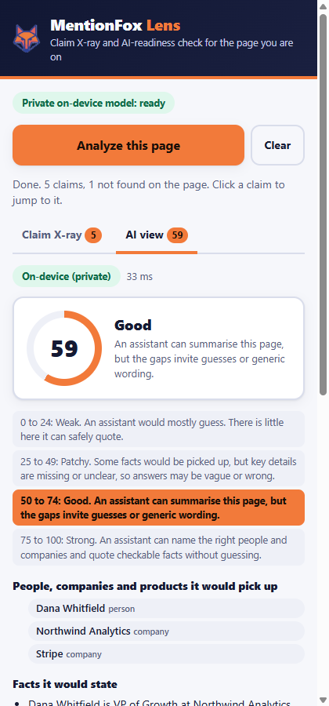
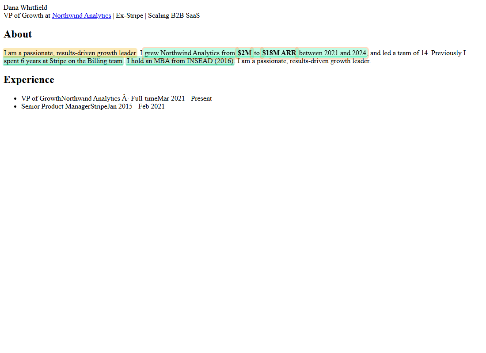

# MentionFox Lens

Free, open-source Chrome extension (Manifest V3) that reads the page you are on and does two things:

1. **Claim X-ray.** Finds the factual claims on the page (profile, bio, press release, pitch, post), highlights each one in place, and labels it *specific and checkable* or *vague or puffery* with a one-line reason. A side panel lists the claims; clicking one scrolls to the exact highlighted text and flashes it.
2. **GEO lens.** Shows how an AI assistant would summarise the page: the people, companies and products it would pick up, the facts it would state, what is missing or ambiguous, three concrete fixes, and a 0 to 100 score with a plain explanation of each range.

Every run shows a **mode badge** ("On-device (private)" or "Cloud") and the latency in milliseconds, so you can see hybrid inference working.

Built for the [#BuildHybridAI 2026 hackathon](https://firebasehybridaihackathon.devpost.com/) with **Firebase AI Logic hybrid inference**: the model runs on-device with **Gemini Nano in Chrome** when it is available, and falls back to the cloud when it is not.

Free to use. No account, no paywall, nothing sent to MentionFox servers. The two links at the bottom of the panel open MentionFox in a new tab and are the only upsell.

<!-- Screenshots: add real captures from a Chrome with the on-device model (see "What the owner must test"). -->
| Claim X-ray | AI view | Highlights in place |
|---|---|---|
|  |  |  |

The screenshots above are **test-harness captures with a mocked model on a synthetic fixture page** (see "Verification"). They show the UI, not real model output. Replace them with real captures before publishing.

## How hybrid inference is used

All AI calls live in [`src/ai.js`](src/ai.js) and run in the side panel (an extension page), where Chrome's `LanguageModel` API is visible to the SDK.

| What | Where |
|---|---|
| Imports `getAI`, `getGenerativeModel`, `InferenceMode`, `InferenceSource` from `firebase/ai` | `src/ai.js` line 5 |
| Firebase App Check (debug token in dev builds), then `getAI(app, { backend: new GoogleAIBackend() })` | `getAiInstance()` |
| `getGenerativeModel(ai, { mode: InferenceMode.PREFER_ON_DEVICE, onDeviceParams, inCloudParams })` | `createHybridModel()` |
| On-device structured output: `onDeviceParams.promptOptions.responseConstraint` (JSON Schema). Cloud structured output: `inCloudParams.generationConfig.responseSchema` built by `toFirebaseSchema()` | `createHybridModel()` |
| `model.initializeDeviceModel(onProgress)` starts the on-device download from the Analyze click (user gesture) and reports progress, shown as a progress bar | `initDevice()` |
| `model.generateContent(prompt)`, then `response.inferenceSource` (`on_device` or `in_cloud`) feeds the mode badge. If the SDK reports no source, the badge falls back to the `LanguageModel.availability()` reading and is labelled "mode inferred" | `runTask()` |
| Quality fallback: if an on-device answer cannot be parsed, retry once with `InferenceMode.ONLY_IN_CLOUD` | `runTask()` |
| Availability probe (`LanguageModel.availability()`) for the status chip: ready, needs download, downloading, not available | `probeDevice()` |

Behaviour when the on-device model is missing: the SDK routes the request to the cloud (`PREFER_ON_DEVICE`), the badge says "Cloud", and the status chip explains why. While a download runs, requests are served by the cloud and the progress bar shows the download.

The prompts and JSON schemas are in [`src/shared/prompts.js`](src/shared/prompts.js). Instructions are inside the prompt text because the SDK's on-device adapter does not pass a system instruction. Page text is capped at 12,000 characters to stay inside the on-device token budget.

Cloud fallback model: the SDK's hybrid default, `gemini-3.5-flash-lite` (set in `CLOUD_MODEL`).

## Privacy

- On-device where possible: when Chrome can run the on-device model, the page text never leaves your computer.
- Cloud fallback: when it cannot, the page text is sent to **Firebase AI Logic** (Google), and only when you click **Analyze**. Nothing is sent when you just browse.
- Nothing is sent to MentionFox servers. The extension has no MentionFox backend and no analytics.
- The extension reads a tab only when you act on it: it uses `activeTab` and `chrome.scripting` on demand. There is no always-on content script and no host permission.
- The links to MentionFox carry only UTM tags, never page content.

Permissions: `activeTab`, `scripting`, `sidePanel`. Nothing else.

## Setup

Requirements: Node 20+, Chrome 139+ on desktop for the on-device path (cloud fallback works in any Chromium that supports side panels).

```bash
git clone https://github.com/OsakaSaul/mentionfox-lens.git
cd mentionfox-lens
npm install
npm test                 # unit tests
npm run build:dev        # dev build with the App Check debug provider
```

Load unpacked: open `chrome://extensions`, turn on Developer mode, click **Load unpacked**, pick the `dist` folder. Pin the Lens icon. On a page, click the icon, then **Open Lens side panel**, then **Analyze this page**. (An `Alt+Shift+L` shortcut is registered for the same action; it has not been tested.)

`npm run build` makes a release bundle (minified, no debug provider).

### Firebase config

The public web config is committed in [`src/firebase-config.js`](src/firebase-config.js) (project `mentionfox-lens`). These values are identifiers, not secrets. To point a build at your own Firebase project, create `.env.local` (gitignored) with any of `FIREBASE_API_KEY`, `FIREBASE_AUTH_DOMAIN`, `FIREBASE_PROJECT_ID`, `FIREBASE_STORAGE_BUCKET`, `FIREBASE_MESSAGING_SENDER_ID`, `FIREBASE_APP_ID`; the build overrides the committed values with them.

Your project needs Firebase AI Logic enabled with the Gemini Developer API. Restrict the API key to the AI Logic and App Check APIs; browser-key referrer restrictions must allow your `chrome-extension://<id>/*` origin.

### App Check debug token (dev builds)

Firebase AI Logic requires App Check. A Chrome extension cannot load reCAPTCHA (remote code), so builds for this project use the **debug provider**:

1. `node scripts/gen-debug-token.mjs` writes a random UUID to `.env.local` as `APPCHECK_DEBUG_TOKEN` (gitignored).
2. `npm run build:dev` sets `self.FIREBASE_APPCHECK_DEBUG_TOKEN` to that value before `initializeAppCheck` (see `getAiInstance()` in `src/ai.js`). If you build without a token, the dev build sets it to `true` instead and the SDK prints a fresh token in the side panel's DevTools console ("Firebase App Check debug token: ...").
3. In the Firebase console go to **App Check > Apps > your web app > Manage debug tokens** and register that value.

The token lives only in `.env.local` and in dev bundles under `dist/` (gitignored). It is never committed. Release builds contain no debug provider, so **cloud fallback in a release build will be refused by App Check** until an attestation path exists for extensions; the on-device path does not call App Check. The hackathon rules say debug tokens are accepted in submissions.

## Tests and verification

```bash
npm test          # 44 unit tests (parsing, matching, GEO score, manifest)
npm run e2e       # loads the built extension in Chromium against HTML fixtures; model MOCKED
node scripts/live-probe.mjs   # real, unmocked run of the dev build; writes docs/live-probe.txt
```

Unit tests cover: prompt and JSON parsing with fenced, trailing-text, trailing-comma, truncated and garbage output; claim-to-range matching (whitespace, case, curly quotes, dashes, multi-element ranges, re-render recovery, Custom Highlight API fallback) against four HTML fixtures shaped like a LinkedIn profile, an X post, a company site and a news article; the GEO score and bands; and manifest rules (MV3, permission allow-list, no host permissions, CSP, no remote scripts, no eval in the bundle, tooltips and accessible names on every control, no model names in UI strings).

The fixtures are **hand-written approximations of those layouts**, not saved copies of real pages. Nothing was logged in to. Real LinkedIn and X markup changes often; the matcher works on rendered text, not class names, which is why it should survive that, but it has not been run on the live sites.

The e2e run (`docs/e2e-run.txt`) verifies the extension loads, the content script is injected on demand, claims are wrapped in place, a click on a claim scrolls to and flashes the exact text, clear removes everything, and both mode badges render. **The model is mocked there**, so it says nothing about model quality or about Gemini Nano.

### Run log

| Mode | Status | Evidence |
|---|---|---|
| On-device (Gemini Nano) | **Not run.** The Chromium used for CI (version 151) exposes `LanguageModel` but reports `availability() = unavailable`, with or without the Prompt API feature flags, so no on-device answer was produced. | `docs/live-probe.txt`, `docs/live-probe-nano-flags.txt` |
| Cloud fallback | **Reached the cloud endpoint, no model answer yet.** The request went to `firebasevertexai.googleapis.com` and was refused with 401 because the App Check debug token was not yet registered in the Firebase console (token exchange returned 403). Registering the token is the remaining step. | `docs/live-probe.txt` |
| Extension shell (mocked model) | 31 of 31 checks pass | `docs/e2e-run.txt` |

### What the owner must test in Chrome (on-device path)

1. Use desktop Chrome 139 or newer on a machine that meets Chrome's on-device model requirements (storage and GPU or CPU limits).
2. Open `chrome://flags/#prompt-api-for-gemini-nano`, set it to **Enabled** (if the page also lists `#optimization-guide-on-device-model`, set it to **Enabled BypassPerfRequirement**), restart Chrome.
3. Open `chrome://components` and click **Check for update** on **Optimization Guide On Device Model**. A version other than 0.0.0.0 means the model is installed.
4. Load the extension (dev build), open a page with a profile or press release, open the side panel. The chip should read "Private on-device model: ready" (or "downloads on first Analyze").
5. Click **Analyze this page**. Look for: the progress bar during a first download; the badge **On-device (private)** with a latency in ms; the claims highlighted on the page; the AI view with a score.
6. To see the fallback, run on a browser or profile without the model: the badge must say **Cloud** and the chip must say on-device is not available.
7. Open DevTools on the side panel (right-click, Inspect) to see SDK logs, including the App Check debug token line.

## How this meets each hackathon rule

| Rule (from the Devpost page) | How | Where |
|---|---|---|
| Build a Gen AI application using Firebase AI Logic | All model calls go through the Firebase JS SDK `firebase/ai` | `src/ai.js` |
| Firebase AI Logic hybrid inference: on-device when available, cloud fallback | `getGenerativeModel` with `InferenceMode.PREFER_ON_DEVICE`, `onDeviceParams` and `inCloudParams` | `createHybridModel()`, `runTask()` |
| Web (Chrome) with Gemini Nano, web app or Chrome extension | MV3 Chrome extension; the on-device path is Chrome's Prompt API (Gemini Nano) reached through the SDK | `manifest.json`, `src/ai.js` |
| Firebase AI Logic requires App Check; debug tokens accepted | App Check initialised before AI Logic; debug token via `self.FIREBASE_APPCHECK_DEBUG_TOKEN` in dev builds | `getAiInstance()` |
| Repository must demonstrate Firebase AI Logic at runtime, imported and actually called, not just named in the README | `import ... from "firebase/ai"`, then `getGenerativeModel`, `initializeDeviceModel`, `generateContent` run on every Analyze | `src/ai.js`, called from `src/sidepanel/sidepanel.js` `analyze()` |
| Public repository with a detectable open-source license | Public GitHub repo, MIT `LICENSE` | `LICENSE` |
| Instructions required to run | This README | `README.md` |
| Project available free of charge | No paywall, no account; upgrade links are outbound only | `src/shared/links.js` |
| Demo video (YouTube), text description, URL to the project | **Not part of this repo.** To be produced by the owner | NEEDS OWNER |

Deadline per the Devpost page: Nov 30, 2026, 2:00 PM PST.

## Project layout

```
manifest.json            MV3 manifest (activeTab, scripting, sidePanel)
src/ai.js                Firebase AI Logic hybrid inference
src/firebase-config.js   public Firebase web config
src/sidepanel/           side panel UI (html, css, js)
src/popup/               toolbar popup launcher
src/content.js           injected on demand: text extraction + highlighting
src/shared/              prompts, JSON parsing, text matching, highlighter, GEO score, links
src/e2e-mock.js          test-harness model mock (only in `build:e2e`)
scripts/                 build, debug token, e2e, live probe
test/                    unit tests and HTML fixtures
```

## Known limits

- Claim extraction is a model judgement. "Specific and checkable" means a third party could check it, not that it is true.
- On-device requests are capped at about 9k tokens, so Lens reads the first 12,000 characters of the main text of the page.
- A claim is highlighted only if the model copied it closely enough to be found in the page text (exact, whitespace-insensitive, or head-and-tail anchored). Others are listed as "Not found on the page".
- Release builds cannot reach the cloud while App Check enforcement is on and no attestation provider exists for extensions.
- The side panel needs the page to be activated for the extension (click the toolbar icon on that page) because the permission model is `activeTab`.

## License

MIT, see [LICENSE](LICENSE).
